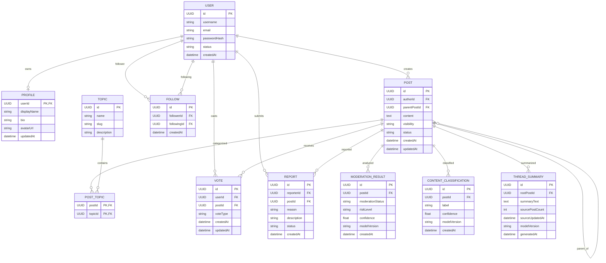

# Mô tả nghiệp vụ

## PigeonNet

Hệ thống là một nền tảng mạng xã hội cho phép người dùng chia sẻ nội dung dưới dạng bài viết, tham gia thảo luận, phản hồi các bài viết của người khác và đánh giá nội dung thông qua cơ chế Upvote/Downvote.

Khác với mô hình mạng xã hội truyền thống sử dụng hai đối tượng Post và Comment riêng biệt, hệ thống thống nhất toàn bộ nội dung thảo luận thành một Resource duy nhất là Post.

Mỗi Post có thể là:

- **Original Post:** Bài viết nguyên bản, khởi tạo một cuộc thảo luận.
- **Reply Post:** Bài viết phản hồi trực tiếp một Post khác.

Các Reply Post có thể tiếp tục nhận phản hồi, hình thành cấu trúc thảo luận phân cấp (nested discussion/thread) thông qua trường `parentPostId`. Nhờ đó, người dùng có thể tham gia thảo luận nhiều tầng mà không cần một cơ chế Comment riêng biệt.

Hệ thống sử dụng cơ chế Upvote/Downvote để cộng đồng đánh giá chất lượng nội dung. Đồng thời, người dùng có thể theo dõi những người dùng khác, khám phá bài viết theo chủ đề và báo cáo nội dung không phù hợp.

Bên cạnh các nghiệp vụ mạng xã hội cốt lõi, hệ thống tích hợp AI nhằm hỗ trợ quản lý chất lượng nội dung và nâng cao trải nghiệm thảo luận, tập trung vào hai khả năng chính:

- **Content Moderation:** Tự động phân tích và phát hiện nội dung có dấu hiệu vi phạm (dựa trên `MODERATION_RESULT`).
- **Content Labeling & Classification (Dán nhãn & Phân loại nội dung):** AI tự động phân tích văn bản của bài viết để dán nhãn (label) và phân loại bài viết vào các nhóm chủ đề (Topic) phù hợp một cách tự động (dựa trên `CONTENT_CLASSIFICATION`). Điều này giúp việc gợi ý, tìm kiếm và lọc nội dung theo chủ đề trở nên chính xác và tự động hóa cao hơn.

-> Hệ thống hướng đến việc xây dựng một môi trường thảo luận trực tuyến có cấu trúc, nơi nội dung được quản lý thống nhất, cộng đồng có thể tham gia đánh giá và AI đóng vai trò hỗ trợ kiểm duyệt, phân loại thông tin.

---

## 🛠 Tech Stack

| Thành phần       | Công nghệ              | Mô tả / Vai trò                                                                                      |
| :------------------- | :------------------------- | :-------------------------------------------------------------------------------------------------------- |
| **Frontend**       | React (Vite, JavaScript) | Xây dựng giao diện người dùng (SPA), quản lý state, hiển thị luồng thảo luận dạng nested. |
| **Backend**        | FastAPI (Python)         | Xử lý API RESTful, hiệu năng cao (async/await), tự động sinh tài liệu Swagger UI/ReDoc.        |
| **Database**       | MySQL                    | Cơ sở dữ liệu quan hệ lưu trữ User, Post, Topic, Vote, và các kết quả phân tích từ AI.    |
| **Authentication** | JWT                      | Xác thực và phân quyền (sử dụng Bearer Token).                                                   |

---

**JWT (JSON Web Token)**:

- Mọi API bảo vệ yêu cầu header: `Authorization: Bearer <access_token>`.
- JWT chứa các claims cơ bản: `sub` (userId), `role` (user/admin), và thời gian hết hạn (`exp`).

---

## 🌐 RESTful API & Data Model Resource Design

Dưới đây là một số endpoint dự kiến:

### 1. Authentication Resource

| Method | Endpoint                | Chức năng                                          |
| :------- | :------------------------ | :----------------------------------------------------- |
| `POST` | `/api/v1/auth/register` | Đăng ký tài khoản mới (tạo User và Profile). |
| `POST` | `/api/v1/auth/login`    | Đăng nhập, trả về Access Token (JWT).           |

### 2. Users & Profiles Resource

| Method   | Endpoint                          | Chức năng                                     |
| :--------- | :---------------------------------- | :------------------------------------------------ |
| `GET`    | `/api/v1/users/{user_id}`         | Lấy thông tin cơ bản của user.             |
| `GET`    | `/api/v1/users/{user_id}/profile` | Lấy thông tin Profile (bio, avatar).          |
| `PATCH`  | `/api/v1/users/me/profile`        | Cập nhật thông tin Profile (yêu cầu Auth). |
| `POST`   | `/api/v1/users/{user_id}/follow`  | Theo dõi một user khác.                      |
| `DELETE` | `/api/v1/users/{user_id}/follow`  | Bỏ theo dõi.                                  |

### 3. Posts Resource (Hỗ trợ Nested Thread)

| Method   | Endpoint                          | Chức năng                                                           |
| :--------- | :---------------------------------- | :---------------------------------------------------------------------- |
| `GET`    | `/api/v1/posts`                   | Lấy danh sách bài viết gốc (Original Post) phân trang.          |
| `POST`   | `/api/v1/posts`                   | Tạo bài viết gốc mới.                                            |
| `GET`    | `/api/v1/posts/{post_id}`         | Lấy chi tiết một bài viết.                                       |
| `GET`    | `/api/v1/posts/{post_id}/replies` | Lấy danh sách các bài viết phản hồi (Reply Post) trực thuộc. |
| `POST`   | `/api/v1/posts/{post_id}/replies` | Tạo bài viết phản hồi (gắn `parentPostId` = `post_id`).         |
| `DELETE` | `/api/v1/posts/{post_id}`         | Xoá bài viết (yêu cầu Auth & quyền sở hữu).                   |

### 4. Interactions Resource (Votes & Reports)

| Method | Endpoint                          | Chức năng                                                      |
| :------- | :---------------------------------- | :----------------------------------------------------------------- |
| `POST` | `/api/v1/posts/{post_id}/votes`   | Upvote hoặc Downvote bài viết (Body: `{ "voteType": "UP" }`). |
| `POST` | `/api/v1/posts/{post_id}/reports` | Báo cáo bài viết vi phạm (Body: `reason`, `description`).   |

### 5. Topics Resource

| Method | Endpoint                      | Chức năng                                                |
| :------- | :------------------------------ | :----------------------------------------------------------- |
| `GET`  | `/api/v1/topics`              | Lấy danh sách các chủ đề hiện có.                  |
| `GET`  | `/api/v1/topics/{slug}/posts` | Lấy danh sách bài viết thuộc một chủ đề cụ thể. |

### 6. AI Results Resource (Internal)

| Method | Endpoint                            | Chức năng                                                                                     |
| :------- | :------------------------------------ | :------------------------------------------------------------------------------------------------ |
| `GET`  | `/api/v1/posts/{post_id}/ai-labels` | Lấy kết quả phân loại/dán nhãn chủ đề của bài viết (từ `CONTENT_CLASSIFICATION`). |

---

## 📊 ERD

