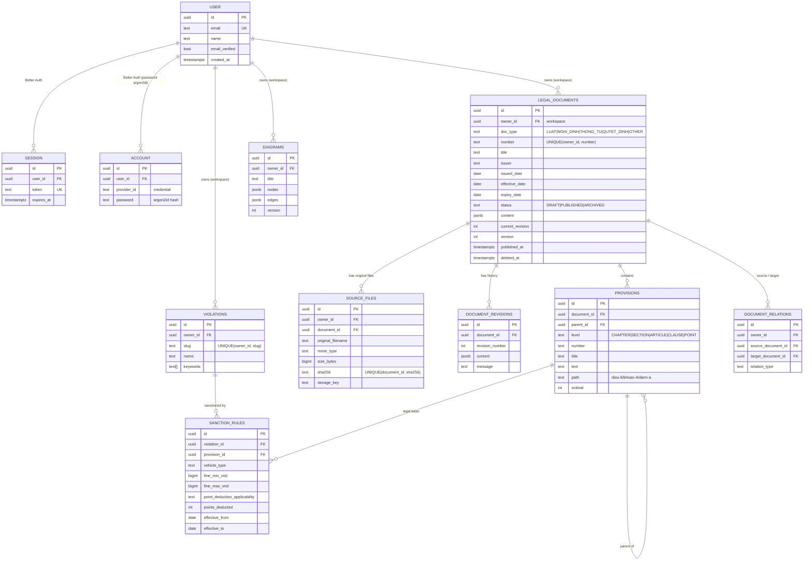

# 03 — Domain model, ERD & Resource model

## 1. Domain model (khái niệm)
- **User** (Better Auth) = một **workspace** riêng. Mọi tài nguyên nghiệp vụ gốc thuộc đúng một user (`owner_id`).
- **SourceFile**: file gốc (PDF/DOCX/TXT) upload cho văn bản; nội dung ở FileStorage, DB giữ metadata + SHA-256.
- **LegalDocument** (văn bản) có nhiều **DocumentRevision** (lịch sử content) và một cây **Provision** (Chương/Mục/Điều/Khoản/Điểm) dẫn xuất từ revision hiện tại.
- **DocumentRelation** là quan hệ có hướng giữa hai văn bản (tuỳ chọn trỏ tới provision cụ thể).
- **Violation** (hành vi) là danh tính độc lập; có nhiều **SanctionRule**, mỗi rule có căn cứ là một Provision và
  thuộc một **lineage** = (violation, vehicle_type).
- **Diagram** là tài liệu của **User**, chứa node/edge có thể tham chiếu Document/Provision/Violation.

## 2. ERD (database schema — PostgreSQL)



Đã có trong 1.0.0 (migration `api/drizzle/`): `user, session, account, verification, legal_documents, source_files`.
Các bảng còn lại là thiết kế cho tuần 13–14.

Index chính: `legal_documents(owner_id, number)` unique (partial, chưa xoá), `legal_documents(owner_id, status, issued_date)`, `source_files(document_id, sha256)` unique, `legal_documents(status, issued_date)`, GIN `search_vector`,
`provisions(document_id, path)` unique, `sanction_rules(violation_id, vehicle_type, effective_from)`,
exclusion constraint chống chồng lấn khoảng hiệu lực (`daterange` + `btree_gist`), `diagrams(owner_id)`.

## 3. Resource model (API) & khác biệt với DB schema

```
/api/v1
/api/auth/*                                              Better Auth (ngoài /api/v1)
/api/v1  — mọi resource ngầm thuộc workspace của user đăng nhập
├── /users/me
├── /legal-documents                                       collection
│   └── /{document_id}                                     item
│       ├── /source-files                                  sub-collection: upload multipart, list
│       ├── /content                                       singleton sub-resource (PUT thay thế)
│       ├── /revisions · /revisions/{revision_number}      sub-collection chỉ đọc
│       ├── /provisions                                    sub-collection chỉ đọc (dẫn xuất)
│       └── /relations                                     view: quan hệ vào/ra
├── /source-files/{file_id} · /source-files/{file_id}/content   item phẳng + tải file
├── /provisions · /provisions/{provision_id}               truy cập phẳng + full-text
├── /document-relations · /{relation_id}                   association resource (n–n)
├── /violations · /{violation_id}
│   └── /sanction-rules                                    sub-collection
├── /sanction-rules/{rule_id}                              item phẳng
└── /diagrams · /{diagram_id}
```

| Khía cạnh | DB schema | API resource | Lý do |
|---|---|---|---|
| Nội dung văn bản | `legal_documents.content` + `document_revisions` + `provisions` | `content` là sub-resource riêng; `provisions` chỉ đọc | Tách metadata (PATCH nhỏ) khỏi content lớn (PUT có ETag); provision là dẫn xuất, không cho client ghi trực tiếp ⇒ một nguồn sự thật |
| Trạng thái chế tài | không lưu | `status` tính theo `as_of` | Tránh dữ liệu cũ khi ngày thay đổi |
| `current_sanctions` của hành vi | join `sanction_rules` | field computed trong `Violation` | Consumer cần một request để hiển thị |
| `citation` của provision | ghép từ `path` + `legal_documents.number` | field computed | DX: chuỗi trích dẫn chuẩn sẵn dùng |
| Field nội bộ | `owner_id`, `deleted_at`, `storage_key`, bảng `session`/`account` | không expose | Bảo mật / leaky abstraction |
| Workspace | cột `owner_id` mọi bảng gốc | không xuất hiện trong URL/JSON | Scope ngầm theo phiên (ADR 0005) |
| File gốc | metadata ở DB, bytes ở FileStorage | `SourceFile` + `/content` riêng | JSON metadata nhẹ, tải nội dung khi cần |
| Khoá | UUID + natural key | dùng UUID trong URL; natural key để filter (`?number=`) | ID ổn định khi số hiệu bị đính chính |
| Phiên đăng nhập | bảng `session` (Better Auth) | không phải resource `/api/v1`; chỉ qua `/api/auth/*` | Do thư viện quản lý |
