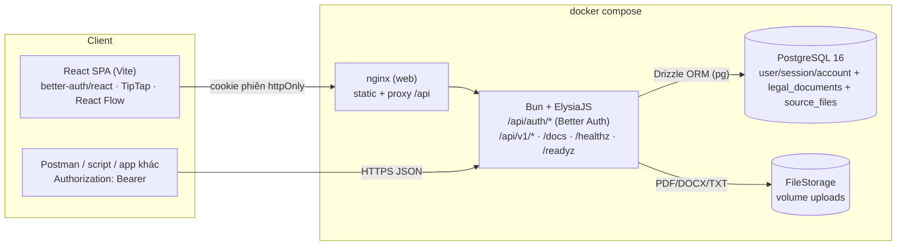
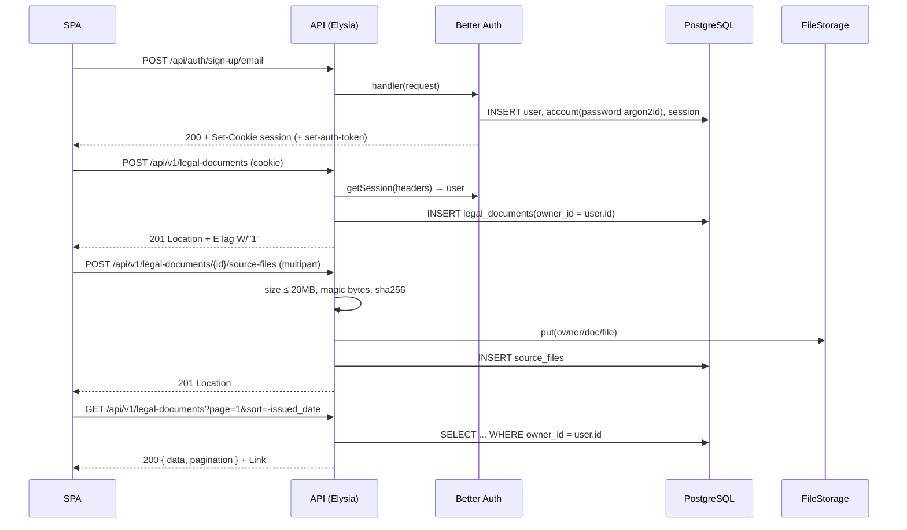

# 04 — Kiến trúc hệ thống

## 1. Tổng quan



- **Stateless API process**: phiên nằm trong DB (Better Auth), không sticky session ⇒ scale ngang được.
- SPA và API **cùng origin** (Vite proxy khi dev, nginx khi chạy Docker) ⇒ cookie SameSite=Lax hoạt động, không cần CORS cho SPA.
- Mỗi request `/api/v1` = một user = một **workspace**; dữ liệu cách ly bằng `owner_id` ở tầng service.

## 2. Công nghệ (ADR 0001, 0005, 0006)
| Lớp | Công nghệ | Lý do ngắn |
|---|---|---|
| Runtime | Bun | Nhanh, có sẵn test runner, Argon2id (`Bun.password`), kế thừa repo gốc |
| HTTP | ElysiaJS + TypeBox | Validation khai báo cạnh route, `app.handle()` cho test |
| Auth | Better Auth (+ `bearer`, `openAPI`) | Không tự viết auth; session thu hồi được; rate limit sẵn |
| ORM / migration | Drizzle + drizzle-kit | Type-safe, SQL migration review được |
| DB | PostgreSQL 16 (test: PGlite) | JSONB cho content/diagram, full-text, exclusion constraint |
| Frontend | React 19, Vite, TanStack Query, React Router 7 | Nhóm quen React; cache + phân trang |
| Editor / Diagram | TipTap / @xyflow/react | Xuất JSON có cấu trúc ⇒ API validate được |
| Test | bun test, PGlite, Newman, Spectral, k6, Playwright, Vitest | Theo B8 |
| Đóng gói | Docker (oven/bun, nginx), docker compose | Tái hiện môi trường (tuần 14) |

## 3. Kiến trúc backend
```
Request ─► onRequest: X-Request-Id, security headers, 415 nếu Content-Type sai
        ─► /api/auth/*  → Better Auth handler (đăng ký, đăng nhập, phiên, rate limit)
        ─► /api/v1/*    → module.use(requireUser)  ← DENY mặc định, gắn `user` (= tenant)
                         → routes.ts (TypeBox validate) → service.ts (nghiệp vụ, lọc owner_id) → Drizzle → PostgreSQL
                                                                                         └──────→ FileStorage
        ─► onError: ProblemError / VALIDATION / PARSE / NOT_FOUND / lỗi khác → application/problem+json
        ─► onAfterResponse: log JSON (request_id, status, duration_ms)
```
Module hiện có: `health`, `users`, `legal-documents`, `source-files`. Theo kế hoạch: `content/revisions/provisions`,
`document-relations`, `violations` (+ `sanction-rules`), `diagrams`. Logic thuần (đánh số Điều/Khoản/Điểm, parser) đặt
trong file riêng (`numbering.ts`) để unit test không cần DB.

## 4. Luồng 1.0.0: đăng ký → tạo văn bản → upload → list


## 5. Luồng tương lai: lưu nội dung soạn thảo
`GET /legal-documents/{id}/content` (ETag) → soạn Điều/Khoản/Điểm → `PUT …/content` (If-Match) → server validate cây,
chuẩn hoá số, tạo revision, tái sinh provisions; lỗi cấu trúc ⇒ 422 `INVALID_PROVISION_HIERARCHY`, lệch phiên bản ⇒ 412.

## 6. Môi trường
| Môi trường | Cách chạy | Dữ liệu |
|---|---|---|
| Local dev | `bun run dev` (api) + `bun run dev` (frontend), Postgres local/compose | tự đăng ký |
| Local full | `docker compose up --build` → web :8080, api :8000 | volume `pgdata`, `uploads` |
| Test | `bun test` với PGlite in-memory | mỗi file test một DB mới |
| Staging (tuần 14) | VM / Render / Railway (chọn sau) | seed demo |
Phương án dự phòng demo: video quay sẵn + ảnh bằng chứng trong `docs/evidence/` + Docker local trên 2 máy.
