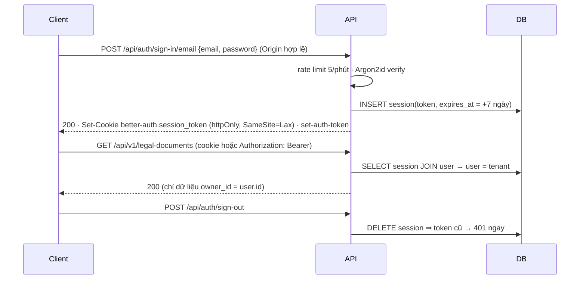

# 07 — Security design & review

Rule: [`../ai-rules/05-auth-security.md`](../ai-rules/05-auth-security.md) · ADR: [`adr/0005-auth-better-auth-workspace.md`](adr/0005-auth-better-auth-workspace.md)

## 1. Xác thực (Better Auth)

**Vì sao session DB thay vì JWT tự làm**: thu hồi ngay khi đăng xuất/đổi mật khẩu, không phải quản lý refresh rotation;
thư viện được duy trì xử lý CSRF (kiểm tra Origin), rate limit, hash. Đổi lại: mỗi request thêm 1 truy vấn session
(theo dõi khi load test; có thể bật cookie cache).

## 2. Mô hình phân quyền: workspace riêng
| Hành động | Khách | Chủ workspace | Tài khoản khác |
|---|---|---|---|
| Đăng ký / đăng nhập | ✓ | – | – |
| Đọc / tạo / sửa / xoá văn bản, file, lược đồ | 401 | ✓ | **404** |
| Liệt kê | 401 | chỉ dữ liệu của mình | chỉ dữ liệu của họ |

## 3. OWASP API Security Top 10 (2023)
| Rủi ro | Kiểm soát | Test (✅ đã có) |
|---|---|---|
| API1 BOLA | Mọi truy vấn lọc `owner_id`; sub-resource kiểm tra qua tài nguyên cha; khác workspace ⇒ 404 | ✅ Bob GET/PATCH/DELETE văn bản & file của Alice ⇒ 404; list rỗng |
| API2 Broken Authentication | Better Auth, Argon2id, rate limit sign-in 5/phút, phiên thu hồi được | ✅ sai mật khẩu 401, token rác 401, token sau sign-out 401, hash `$argon2id$` |
| API3 Object Property Level | `additionalProperties: false`, DTO `toXxx()` không có `owner_id`/`storage_key` | ✅ gửi `owner_id` ⇒ 422; response không có `owner_id`/`password` |
| API4 Resource Consumption | `page_size ≤ 100`, upload ≤ 20 MB, rate limit auth | ✅ `page_size=1000` ⇒ 400; file > giới hạn ⇒ 413 |
| API5 Function Level | Không có route admin trong 1.0.0; mọi module `.use(requireUser)` | ✅ không token ⇒ 401 |
| API6 Sensitive Business Flows | Rate limit sign-up 3/phút | thủ công (429) |
| API7 SSRF | Không fetch URL do client gửi | – |
| API8 Misconfiguration | CORS whitelist + credentials, `nosniff`, Secure cookie ở production, 500 không lộ stack | ✅ lỗi trả problem+json |
| API9 Inventory | Contract test: mọi route `/api/v1` phải có trong spec | ✅ `platform.test.ts` |
| API10 Unsafe Consumption | Không gọi API ngoài trong 1.0.0 | – |
| Upload độc hại | Whitelist + magic bytes, tên file làm sạch, key lưu không dùng tên gốc, tải về `attachment` | ✅ PDF giả ⇒ 415, `.exe` ⇒ 415 |

## 4. Dữ liệu nhạy cảm
Không log mật khẩu/token/cookie; `.env` trong `.gitignore`; `BETTER_AUTH_SECRET` chỉ qua env; file upload nằm ngoài web root.

## 5. Kết quả review (tuần 15)
_Điền: phát hiện, mức độ, trạng thái khắc phục, khuyến nghị (rate limit `/api/v1`, quota dung lượng theo workspace, quét virus file)._
